# Kapps Country Flags

A community patch for [Kapps](https://kapps.kutu.ru), the iRacing overlay app whose active development has wound down (it still gets the occasional update). It adds a few features Kapps itself never shipped:

- **Country flags** next to each driver in **Standings** and **Relatives**
- A **Fastest Lap column** in **Standings**, highlighting whoever holds the fastest lap within their own class
- Optional **column titles** in **Standings**, at the top of each class
- Optional **full-colour car logos** in Standings and Relatives
- A **Target Laps** row in the **Fuel Calculator**, showing the fuel-per-lap needed for a couple of laps around your current pace
- An **Avg 5** row in the **Fuel Calculator**, showing a simple average of your fuel usage over the last 5 laps
- A **modern look for the Kapps window**, with a **dark theme toggle** and **tabs for the Racing Overlay widgets** instead of one long list
- Five **new Racing Overlay widgets**: **Weather** (pick and order the conditions you want to see), **Pit Brake**, **Rejoin Helper**, **Delta Bar** and **Flags** (pit timer, limiter, low fuel, start lights, flags and traffic, each badge optional)
- A **banner when a new version of this patch is released**, with a setting to turn it off

## Country flags

Neither Standings nor Relatives shows a driver's country by default. This patch adds a flag icon next to each driver, sourced from the `FlairID` field iRacing's own telemetry already provides (no external API calls, no login required). Drivers without a country set on their iRacing account show a small globe icon instead.

- In **Standings**, the flag is a first-class column fully integrated into the settings editor — it can be dragged, reordered, or removed like any other column.
- In **Relatives**, the flag is a simple on/off toggle (matching how the rest of that widget's settings work) placed right after the "Car Number" option, and displays right after each driver's car number in the overlay.

**Live standings** — a flag appears next to each driver's name during a session:

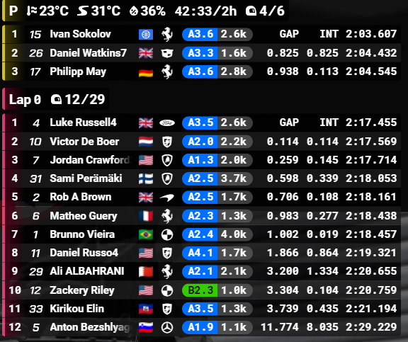

**Standings settings editor** — the flag is a normal, draggable column (`Country Flag`) alongside the built-in ones:

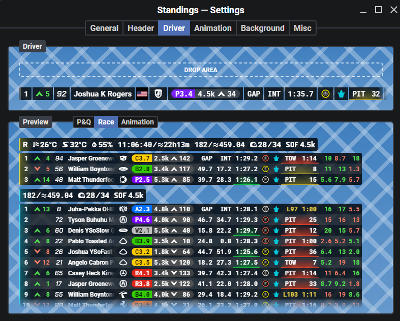

**Live relatives** — the flag appears right after each driver's car number (drivers without a country set show a globe icon, like Simran Gill below):

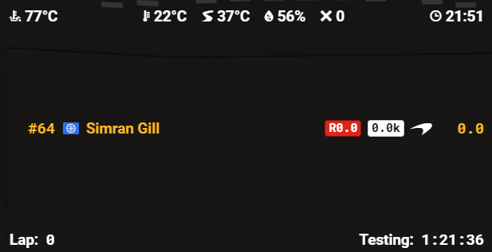

**Relatives settings** — a simple "Country Flag" checkbox right after "Car Number":

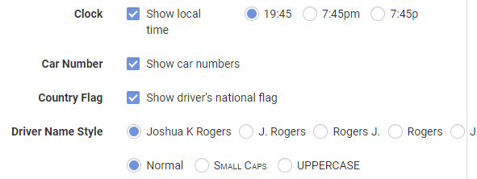

## Fastest Lap column (Standings)

A new draggable/removable column showing each driver's session-best lap time — addable and reorderable in the settings editor exactly like the built-in columns, with the same P&Q/Race precision options (3 precision levels each) that Last Lap Time has.

Whichever driver currently holds the fastest lap **within their own class** (GT3, LMP2, etc. — computed the same way iRacing itself tracks class-relative fastest laps) gets a solid purple highlight, so it's easy to spot at a glance in multiclass races:

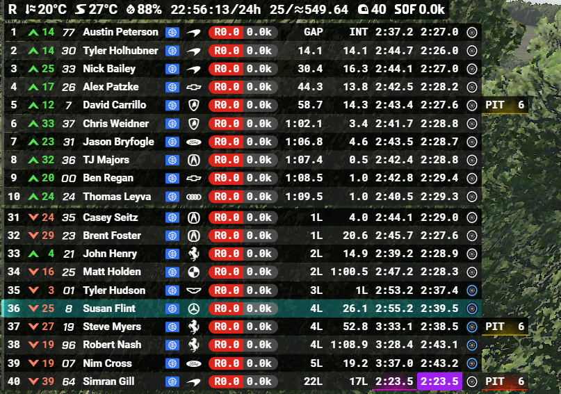

Since a fastest lap in Practice or Qualify is often not that meaningful, the column's settings popup (click/hover the column in the settings editor) has a "Hide in P&Q" checkbox — when enabled, the column stays blank during Practice and any type of Qualify session, and shows normally again in Race:

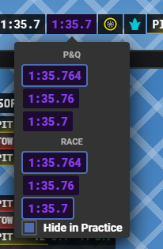

## Column titles (Standings)

Standings doesn't label its columns. Tick **Column Titles** in Standings' settings window (General tab, under "Show Headers") to add a row naming the columns (P, +/-, #, Driver, Rating, Gap, Int, Lap, and so on) at the top of each class, just under the class header. The titles follow whichever columns you've chosen and line up with them.

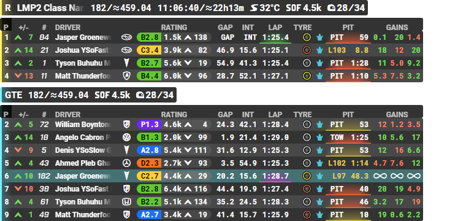

## Full-colour car logos

Kapps shows each car's make as a small white logo in Standings, Standings (Legacy) and Relatives. Tick **Racing Overlay → System → Car Logos → Full colour** to show the makes' own colour logos instead, each on a light tile so dark logos stay visible. The setting is per profile, works for both iRacing and Le Mans Ultimate, and also applies to the Standings settings window's preview.

Le Mans Ultimate makes that Kapps didn't know now get a logo too, in single colour or full colour: Alpine, Peugeot, Lexus, Oreca, Isotta Fraschini, Glickenhaus, Vanwall, Ginetta, Duqueine, Genesis and the current Corvette. Makes whose logo is only a wordmark (McLaren, Dallara, Vanwall, Duqueine, Glickenhaus) get a wider logo in Standings, so they stay readable. In Relatives and Standings (Legacy), where the logo has to fit a square, they're hard to read.

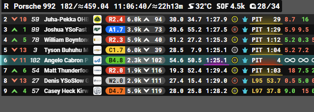

The logos come from [car-logos-dataset](https://github.com/filippofilip95/car-logos-dataset) and Wikimedia Commons. All logos are trademarks of their owners.

## Target Laps and Avg 5 (Fuel Calculator)

Two new rows in the Fuel Calculator overlay:

- **Target Laps**, at the bottom of the overlay, shows the fuel-per-lap needed for the lap you're on pace for, plus one lap on either side — so you can see at a glance what adjusting your pace by a lap or two would cost or save in fuel. Toggled on via a "Target Laps" checkbox in the Fuel Calculator's settings, placed above "Custom".
- **Avg 5**, next to the built-in "Average" row, is a simple (non-trimmed) average of your fuel usage over the last 5 laps — useful right after a pace change, when Kapps' own trimmed-average "Average" row is still catching up. Toggled on via an "Avg 5" checkbox, placed above "Target Laps".

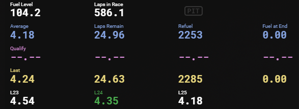

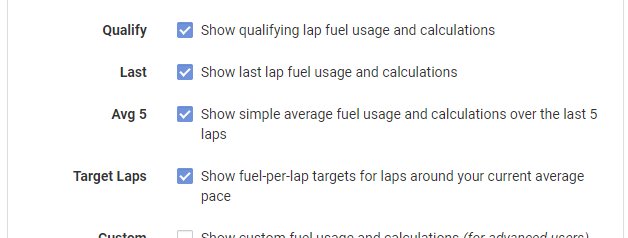

## Modern UI and dark theme

The main Kapps window gets a cleaner, more modern look: rounded cards, softer borders, and tidier inputs, buttons and menus. All the existing sections and pages stay where they were.

- **Dark theme:** the sun/moon button next to minimise switches between light and dark. Until you click it, Kapps follows your Windows light/dark setting. After that it remembers your choice.
- **Game tabs:** the "Apps" tab in the left rail now carries the iRacing logo and is labelled iRacing. Below it is a new **Le Mans Ultimate** tab with the LMU logo (see [Le Mans Ultimate](#le-mans-ultimate)).
- **Racing Overlay widget tabs:** instead of scrolling through every widget's settings in one long list, pick a widget from the row of tabs at the top and only its settings are shown. A green dot marks the widgets that are switched on. Custom Overlays and System have tabs too.

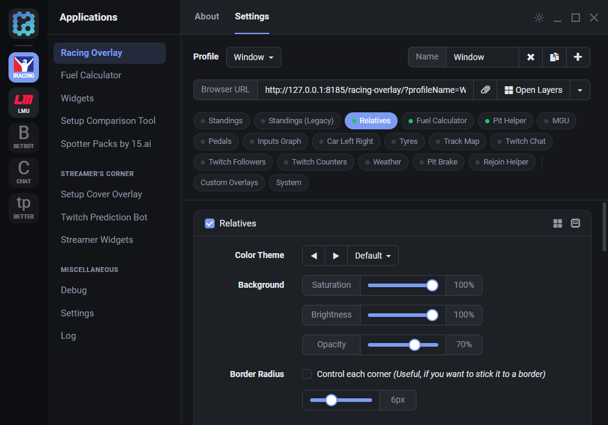

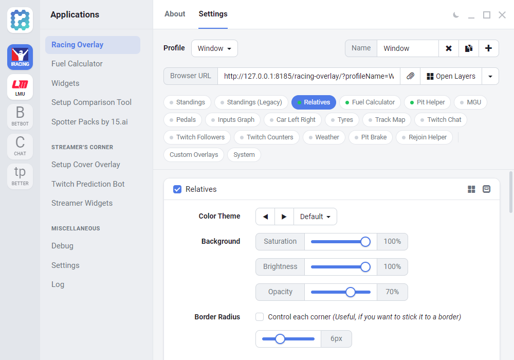

This applies to the main Kapps window. The overlays themselves, and the separate settings windows some widgets open (such as Standings' column editor), are unchanged.

## New widgets: Weather, Pit Brake, Rejoin Helper, Delta Bar and Flags

Five widgets are added to the Racing Overlay, each with its own tab. Kapps' own widgets are all still there. Switch them on from their tab, like any other widget. They can be moved and resized in the overlay's layout editor, or opened as their own layer window.

### Weather

A vertical card of weather information. You choose which rows it shows, and in what order. In the Weather tab's **Information** list, use **Add information** to add a row, the arrows to reorder, and ✕ to remove one. Only weather information can be added:

| Row | Shows |
|---|---|
| Track Temp / Air Temp | Temperatures |
| Wind | Speed, the direction it's coming from, and an arrow showing which way it blows relative to your car |
| Humidity | Relative humidity |
| Sky | Clear, partly cloudy, mostly cloudy or overcast |
| Rain | Precipitation |
| Track Wetness | iRacing's dry → extremely wet scale, with a bar |
| Declared Wet | Whether race control has declared the track wet |
| Fog | Fog level |

Units can follow iRacing's setting or be fixed to metric or imperial. Background opacity is adjustable, and the card scales with its window.

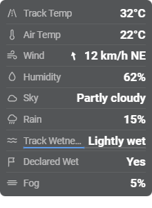

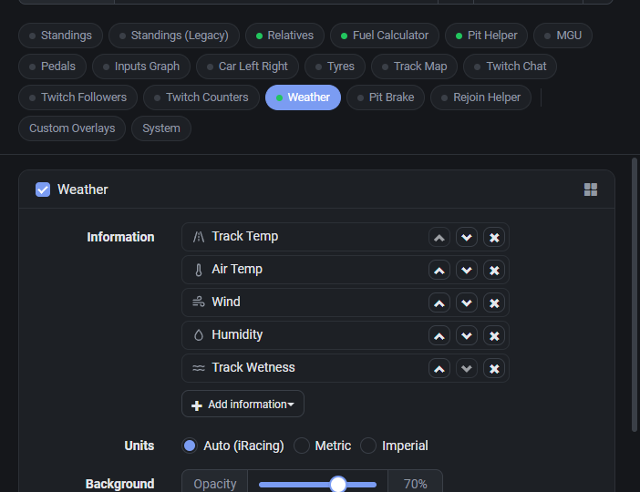

### Pit Brake

Helps you stop on your pit box. On the pit lane it shows **WAIT** and the distance to your braking point. Then it shows **BRAKE** with the distance to the box. Once you're stopped it shows **HOLD** with the services being done (tyres, fuel, fast repair). The braking point uses your speed and a braking strength you can adjust in its tab, so it can be tuned per car if BRAKE comes too early or too late.

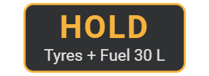

### Rejoin Helper

Appears while you're off track, and optionally when you're stopped or spun on track. It shows how many seconds the nearest car behind is from your spot:
- green **CLEAR**: at or above the "clear" threshold;
- amber **CAUTION**: in between;
- red **DANGER**: at or below the "danger" threshold.

Both thresholds are adjustable. The gap is timed the same way Kapps' own Relatives widget times it.


### Delta Bar

How far ahead or behind a reference lap you are as you drive it. The number shows the delta (green when you're ahead, red when you're behind), and the bar fills from the centre line: right in green when you're ahead, left in red when you're behind. In its tab you can choose:
- what to compare against: your best lap, the session's best lap, your optimal lap, or the session's optimal lap (Le Mans Ultimate only shares your best lap);
- the delta that fills half the bar;
- the number of decimals;
- how long a finished lap's delta stays up after you cross the line;
- whether to show the bar at all.

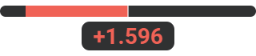

### Flags

A row of badges, each shown only while it applies. In the Flags tab's **Badges** list, use **Add badge** to add one, the arrows to reorder, and ✕ to remove one. They can sit side by side or be stacked.

| Badge | Shows |
|---|---|
| Pit lane timer | Time spent on the pit lane (it stays up for 10 s after you leave), or **PIT CLOSED** |
| Speed limiter | **LIMIT** and your speed while the pit limiter is on |
| Low fuel / energy | Laps of fuel left (or of virtual energy, in Le Mans Ultimate) when fewer than you set |
| Start lights | **READY** before the start, then **GREEN** |
| Yellow flag / caution | **YELLOW** for a local yellow, **CAUTION** for a full-course caution |
| Blue flag | **BLUE** and how long it has been shown |
| Traffic | A faster class closing in behind, with its class and gap in seconds. While you rejoin from the pits, or after being slow or off track, any car closing in counts |
| White / checkered flag | **LAST LAP**, then **FINISH** |
| Black flag / DSQ | **BLACK FLAG**, **REPAIR** (meatball) or **DSQ** |

The low-fuel threshold (laps) and traffic gap (seconds) are adjustable.


The Weather, Pit Brake and Rejoin Helper ideas come from [KAPPS-UPDATE](https://github.com/Canedaaa/KAPPS-UPDATE) by Lucas Caneda, and the Delta Bar and Flags ideas from [TinyPedal](https://github.com/TinyPedal/TinyPedal). These versions were written separately for this patch.

## Le Mans Ultimate

The **Le Mans Ultimate** tab has its own Racing Overlay, with the same widgets and settings as iRacing's but separate profiles and layouts. In Le Mans Ultimate, turn on **Settings → Gameplay → Enable Plugins**. That lets the patch's bridge (`lmu.exe`, which Kapps starts and restarts like its other helpers) read the game's telemetry and serve it to the widgets.

What's different from iRacing:
- Options with nothing behind them in LMU are hidden: SOF, incidents, humidity, rating gain, country flags and joker laps.
- Standings has LMU-only **DMG** (damage), **FUEL** (virtual energy in blue for cars that use it, fuel otherwise) and **TYRES** columns. TYRES shows each wheel's compound, since LMU allows mixing them.
- For cars that run on virtual energy, the **Fuel Calculator** works in percent of VE, shown as **Energy %**: usage per lap, laps remaining and refuel all count VE, the way LMU's pit menu refills it. Cars without VE (LMP2, for example) stay in litres.
- There's no Rating column yet, because LMU's Safety and Driver Ratings aren't available to Kapps. Track Map and Tyres are iRacing-only.
- LMU shares no start lights, so Flags shows READY for the countdown. The Delta Bar compares against your best lap only.
- An LMU-only **Damage** widget (its tab only appears on the LMU tab) shows your car from above:
  - its 8 body zones turn amber, then red, as they're damaged, and flash if the rear wing comes off;
  - the wheels are outlined in red when flat and flash when one comes off;
  - percent damaged is in the middle;
  - a red cone points to where the last impact came from, for a few seconds (adjustable).

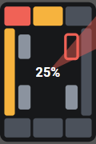

## Fixes to Kapps itself

The patch also fixes bugs in Kapps' own widgets:
- **Fuel Calculator and Relatives, multiclass timed races:** slower classes were told they'd run their own pace's laps, not the overall leader's. That could fuel them a lap short.
- **Fuel Calculator average:** it sorted fuel use as text (10.1 before 9.8), so the wrong laps were dropped from its trimmed average.
- **Standings:**
  - one error froze the widget for good;
  - Gap/Int were wrong on a multiclass grid before the first lap;
  - Live Standings broke in races without qualifying results;
  - LMU classes the bridge doesn't know merged into another class.
- **Car Left Right:** cars in the pit lane and the pace car were taken for the car alongside you.
- **MGU:** it only appeared for a fixed list of hybrid cars. It now appears for any car reporting a battery charge, LMU's hybrids included.
- **Smaller fixes:**
  - Pit Helper and the overlay page kept work running in the background.
  - Twitch Counters froze its viewer count when the stream ended.
  - Relatives' reference laps were checked against the wrong class.

## New release notifications

When a new version of this patch is published on GitHub, Kapps shows a banner across the top of its window with a link to the release page. The ✕ dismisses it for that release; the next release brings it back.

Kapps checks GitHub's [releases page](https://github.com/ssg22/kapps-country-flags/releases) each time it starts. You can turn the check off in **Kapps → Settings → Patch Updates**, which also shows the version you have installed.

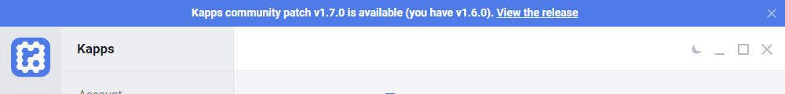

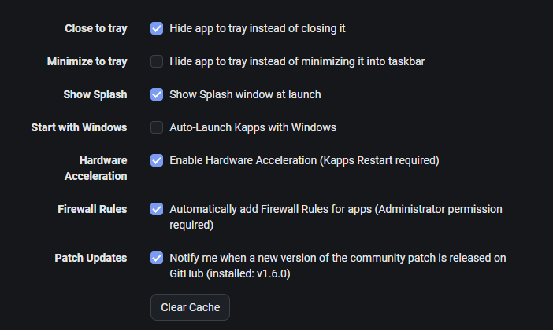

The patch can't update itself: download the new release and run it as described below.

## How it works

Kapps ships as a compiled Electron app — there's no source code or build process to hook into. This patch works by directly editing the minified JavaScript/HTML/CSS bundled inside Kapps' `app.asar` archive (unpack → text-patch → repack), the same file format Electron apps use to package their code. `kapps-country-flags-patch.js` does this programmatically against your own local install, using Kapps' own bundled Node.js runtime (via `ELECTRON_RUN_AS_NODE`) — no separate Node.js install required.

Working on the patch itself? [`tools/`](tools/README.md) has scripts that decompile your local Kapps install into readable code (kept out of git) and run Kapps from it with debuggers attached.

Every string replacement the script makes is guarded: it checks the exact original text exists exactly once before changing anything, and aborts without touching the file if it doesn't. This means if a future Kapps update changes the underlying code, the patch fails loudly instead of silently corrupting your install.

## You are responsible for running this

This script modifies a file inside your own local Kapps installation. It is not an official Kapps update, is not affiliated with or endorsed by Kapps' developer, and comes with no warranty. Review `kapps-country-flags-patch.js` yourself before running it if you want to understand exactly what it changes. By running it, you accept responsibility for the outcome — back up anything you care about first (see below for the automatic backup this script itself makes).

## How to use it

1. **Fully quit Kapps** — tray icon → Quit Kapps (not just closing the window).
2. Download `apply-country-flags-patch.bat` and `kapps-country-flags-patch.js` and put them **in the same folder** together (anywhere — Desktop, Downloads, wherever).
3. Double-click `apply-country-flags-patch.bat`.
4. It will locate your Kapps install automatically, back up the original file, and apply the patch. Follow the on-screen prompts.
5. Relaunch Kapps. Open the Standings overlay during a session to see flags; open Standings' settings → Driver tab to see the draggable `Country Flag` and `Fastest Lap` columns. For Relatives, open its settings page and enable the new "Country Flag" checkbox (found right after "Car Number"). For the Fuel Calculator, open its settings and enable "Avg 5" and/or "Target Laps" (found above "Custom").

### Running it manually instead of the `.bat`

If you'd rather not run a `.bat` file, you can invoke the script directly:

```
set ELECTRON_RUN_AS_NODE=1
"%LOCALAPPDATA%\kapps\app-<version>\Kapps.exe" kapps-country-flags-patch.js
```

You can also pass an explicit path to `app.asar` as an argument if you don't want it auto-detected:

```
"%LOCALAPPDATA%\kapps\app-<version>\Kapps.exe" kapps-country-flags-patch.js "C:\path\to\app.asar"
```

## If something goes wrong — restoring the backup

Before making any change, the script copies your current `app.asar` to `app.asar.original-backup` **in the same folder** (it will not overwrite an existing backup on a second run, so you always have the true original). To undo the patch at any point:

1. Fully quit Kapps.
2. Go to `%LOCALAPPDATA%\kapps\app-<version>\resources\`.
3. Delete (or rename) `app.asar`.
4. Copy `app.asar.original-backup` and rename the copy to `app.asar`.
5. Relaunch Kapps — you're back to a completely stock install.

## If Kapps updates itself

A Kapps update installs into a brand-new `app-<version>` folder with a stock `app.asar`, so **the patch is gone and you just re-run it** — the script always targets the highest installed version. Your previous version's folder is left behind untouched, backup and all.

Verified against Kapps **1.24.36**, **1.24.38** and **1.24.40**. Because every replacement is guarded (see below), a future Kapps update that rewrites the code this patch depends on will make the script stop with an error naming the piece that no longer matches, rather than half-applying.

## Requirements

- Kapps installed locally.
- Windows. The script and `.bat` launcher were built and tested on Windows; no other platform has been tried.
